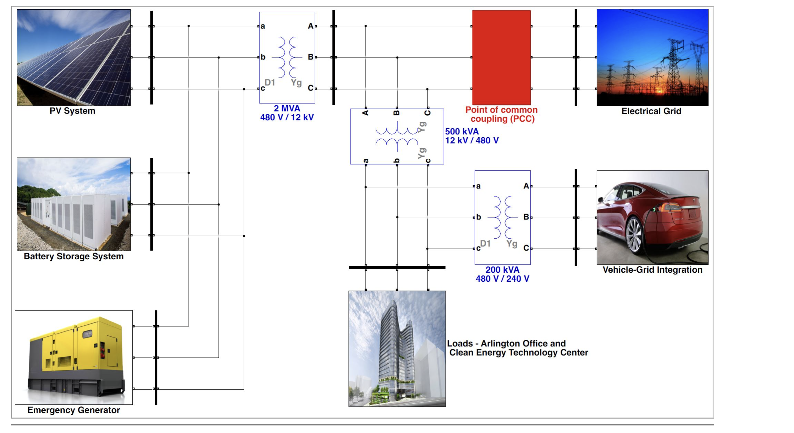

# Real-time Digital Simulation of Microgrid Control Strategies (Matlab)

Real-time digital simulations can be used to evaluate and design microgrid control strategies before actual deployment on-site, without any risk.
The paper mentioned below describes the microgrid model built by Snohomish PUD in Arlington, Washington State. The microgrid is currently in the design phase and is expected to be completed by the end of 2020. It consists of photovoltaic power generation, batteries, emergency generators, loads, and vehicle-to-grid (V2G) charging stations as shown in the figure below. When the microgrid is synchronized with the main grid, the batteries will be used for solar smoothing, peak shaving, and energy arbitrage. Then, the batteries and photovoltaic inverters will operate in grid-connected mode. On the other hand, when the microgrid operates in island mode, the battery inverter will operate in grid-forming mode, while the PV inverter will operate in grid-connected mode. The emergency generator will only be used when the batteries are discharged and PV power generation is insufficient. The batteries of electric vehicles can support both the microgrid and the grid. The simulation model developed using the Simscape Power Systems (formerly known as SimPowerSystems™) toolbox in MathWorks®™ Simulink® is available for public use and can be used to model other microgrids (please refer to the download link below).
Three operational scenarios were studied: grid-connected operation; seamless transition to island mode, where the battery inverter operates in grid-connected mode; and use of the emergency generator during battery discharge for island operation.
Here is the Simulink model to download. You will need RT-LAB to run these models, unless comments indicate that components are not from the Simscape Power Systems™ toolbox. If you have any questions or suggestions about these models, please send an email. The email address can be found in the article below.
Here is our whitepaper to download.
Reference: C. Keerthisinghe, D. S. Kirschen, and S. Gibson "Real-time Digital Simulation of Microgrid Control Strategies," IEEE Power and Energy Society Innovation in Smart Grid Technologies Conference (ISGT), Washington, D.C., USA, February 2020, Pages 1-5.

## Images

<!-- PAYMENT_BLOCK -->

## Get this dataset

- Payment link (Stripe): [Buy now](https://buy.stripe.com/3cs8yP7sY87d0vu9AB)
- Payment QR code: 

<!-- /PAYMENT_BLOCK -->
